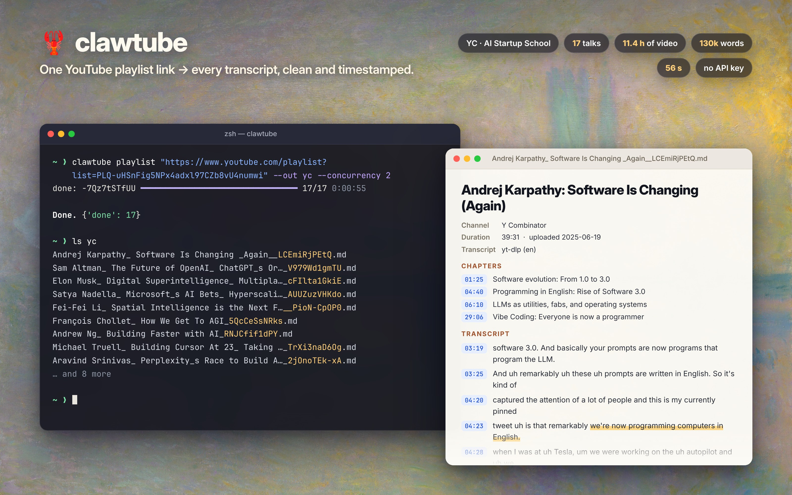

# clawtube 🦞🎬

[](https://pypi.org/project/clawtube/)
[](https://github.com/mehmetresitgul/clawtube/blob/main/LICENSE)
[](https://github.com/mehmetresitgul/clawtube/actions/workflows/ci.yml)
[](https://github.com/mehmetresitgul/clawtube/blob/main/pyproject.toml)
[](https://github.com/mehmetresitgul/clawtube/stargazers)

> Turn one YouTube playlist link into a full set of clean, timestamped transcripts - no API key, no cloud account, runs on your own machine.

clawtube is an [Agent Skill](https://skills.sh) + standalone CLI for extracting YouTube transcripts at scale: a single video, every video in a playlist, or a whole channel in one command. It's built local-first - it never asks you to sign up for a third-party transcript service or hand over an API key.

```bash
pipx install clawtube
clawtube playlist "https://www.youtube.com/playlist?list=PLAYLIST_ID"
```

One Markdown file per video lands in `./clawtube_out`, with chapters and timestamps that link back into the video.

The CLI works anywhere. The skills are written for agent runtimes that support the [Agent Skills](https://skills.sh) format, such as Claude Code, Cursor and Codex.

## Demo

[](https://www.youtube.com/playlist?list=PLQ-uHSnFig5NPx4adxl97CZb8vU4numwi)

A real run, not a mock-up: Y Combinator's [AI Startup School](https://www.youtube.com/playlist?list=PLQ-uHSnFig5NPx4adxl97CZb8vU4numwi) playlist (Andrej Karpathy, Sam Altman, Satya Nadella, Fei-Fei Li, Andrew Ng and more) - 17 talks, 11.4 hours of video, about 130,000 words of timestamped transcript in 56 seconds. (Background: Claude Monet, [*Charing Cross Bridge, London*](https://www.artic.edu/artworks/16544), 1901, Art Institute of Chicago, public domain.) Try it yourself:

```bash
clawtube playlist "https://www.youtube.com/playlist?list=PLQ-uHSnFig5NPx4adxl97CZb8vU4numwi"
```

## Why clawtube

Most transcript tools stop working the moment a video has no manual captions, get blocked as a bot, or die halfway through a long playlist and make you start over. clawtube is built around that:

- **A fallback chain, not a single method.** Direct caption fetch → yt-dlp subtitle extraction → local Whisper transcription. For videos without any caption track, Whisper can still produce a transcript, as long as YouTube lets you download the audio.
- **Gets past bot checks on its own.** When YouTube answers "Sign in to confirm you're not a bot" (common on cloud servers and VPNs), clawtube switches to other YouTube player clients and keeps using the one that works. Tested from a cloud server with no cookies: a full 155-video channel in under 4 minutes, 155/155.
- **The right language.** Without `--langs` you get the video's own language - Turkish captions for a Turkish video, even if it also has an English dub or dozens of community translations.
- **Resumable playlist runs.** Progress is checkpointed to disk. If a 300-video playlist run gets interrupted, re-running the same command picks up exactly where it left off instead of refetching everything. Rate limits are waited out automatically.
- **Zero signup.** No API key, no OTP email flow, no dashboard. Install it and point it at a link.

## Install

clawtube needs Python 3.10+ (3.11+ recommended, so pip can install the newest yt-dlp). It has two parts: the `clawtube` CLI, and optional [Agent Skills](https://skills.sh) that teach an agent when and how to call it. Install the CLI first - the skills just shell out to it.

**1. The CLI**

[pipx](https://pipx.pypa.io/) (or `uv tool install`) keeps clawtube in its own environment and puts `clawtube` on your `PATH`:

```bash
pipx install clawtube
# or: uv tool install clawtube
# or, into the current environment: pip install clawtube
```

With the optional local Whisper fallback (for videos with no captions at all):

```bash
pipx install "clawtube[whisper]"
```

The latest development version straight from GitHub: `pipx install "git+https://github.com/mehmetresitgul/clawtube.git"`.

Check it works: `clawtube --help`. For the most reliable YouTube extraction, have a JavaScript runtime installed - [Deno](https://deno.com/), Node.js or Bun; clawtube enables whichever one it finds so yt-dlp can solve YouTube's player challenge. Audio transcription via `--whisper-fallback` additionally needs [ffmpeg](https://ffmpeg.org/) on your `PATH`.

To update later, which also pulls in the newest yt-dlp (that is what keeps clawtube working when YouTube changes something): `pipx reinstall clawtube` or `uv tool upgrade clawtube`. (`pipx upgrade` alone leaves yt-dlp at its old version.)

**2. The agent skills (optional)**

With the [skills CLI](https://skills.sh):

```bash
npx skills add mehmetresitgul/clawtube --skill clawtube-full
```

Or copy a skill folder from [`skills/`](https://github.com/mehmetresitgul/clawtube/tree/main/skills) into your agent's skills directory by hand, e.g. for Claude Code:

```bash
cp -r skills/clawtube-full ~/.claude/skills/
```

Each skill is a plain `SKILL.md`, so any agent runtime that reads the Agent Skills format can use it.

## Usage

```bash
# One video (watch, youtu.be, shorts and live links all work, as does a bare video id)
clawtube video "https://www.youtube.com/watch?v=VIDEO_ID"

# Every video in a playlist, saved as Markdown
clawtube playlist "https://www.youtube.com/playlist?list=PLAYLIST_ID"

# A whole channel (newest first); --limit keeps it to the latest N videos
clawtube channel "https://www.youtube.com/@ChannelName" --limit 20

# Prefer Turkish captions, fall back to English, also export SRT
clawtube playlist "<playlist-url>" --langs tr,en --formats md,srt

# No captions anywhere? Transcribe locally with Whisper instead of skipping the video
clawtube playlist "<playlist-url>" --whisper-fallback

# Re-run any time - already-fetched videos are skipped automatically
clawtube playlist "<playlist-url>" --out ./my_playlist
```

### Options

| Option | Commands | What it does |
|---|---|---|
| `--out DIR` | all | Output directory (default `./clawtube_out`) |
| `--langs tr,en` | all | Preferred caption languages, in order. Default: the video's own language |
| `--formats md,srt` | all | Also write `.srt` subtitle files next to the Markdown |
| `--whisper-fallback` | all | Transcribe the audio locally when a video has no captions |
| `--cookies-from-browser chrome` | all | Use your browser's YouTube session (also `firefox`, `edge`, `safari`, `chrome:Profile 1`) |
| `--cookies FILE` | all | Same, from a Netscape-format `cookies.txt` export |
| `--limit N` | playlist, channel | Only the first N videos (a channel's newest N) |
| `--concurrency N` | playlist, channel | Videos fetched in parallel (default 4) |
| `--no-resume` | playlist, channel | Ignore the checkpoint and fetch everything again |

Exit code is `0` when everything succeeded, `2` when a playlist/channel run finished with some failed videos, `1` on other errors.

Or, from any agent that has the skill installed, just talk to it:

> "Get transcripts for every video in this playlist: `<url>`, prefer Turkish, and skip any video that's already been done."

## Output

Each video gets its own Markdown file, named `<title>_<video id>.md`, with metadata, chapters (when YouTube provides them), and a timestamped transcript where every line links back to that exact moment in the video:

```
# How Transformers Work

- **Channel:** Example Channel
- **Video:** https://www.youtube.com/watch?v=VIDEO_ID
- **Upload date:** 20240101
- **Duration:** 12:34
- **Transcript source:** timedtext (en)

## Transcript

**[00:00](https://youtu.be/VIDEO_ID?t=0)** Welcome back to the channel...
**[00:12](https://youtu.be/VIDEO_ID?t=12)** Today we're looking at attention...
```

A `.clawtube_state.json` checkpoint in the output directory makes runs resumable, and fetched transcripts are cached in `~/.cache/clawtube`, so fetching the same video again (in another playlist or another output directory) is instant.

## Skills

| Skill | What it does |
|---|---|
| `clawtube-full` | Everything below, in one skill |
| `clawtube-transcript` | Single-video transcript, with timestamps |
| `clawtube-playlist` | Bulk transcript extraction for an entire playlist |

Install a single one with `npx skills add mehmetresitgul/clawtube --skill clawtube-transcript`.

## How the fallback chain works

1. **Direct caption fetch** - hits YouTube's caption endpoint directly for manual or auto-generated captions. Fast, no video/audio download. Skipped for 10 minutes once YouTube blocks it for your IP.
2. **yt-dlp subtitle extraction** - used when (1) turns up nothing. One request lists every caption track and the video's metadata; clawtube picks the track (manual over auto-generated, the original language over translations) and downloads only that one. If YouTube demands a bot check, it retries with other YouTube player clients.
3. **Local Whisper (`--whisper-fallback`)** - for videos with no caption track at all. Downloads audio only (never video) and transcribes on-device with `faster-whisper`. Fully optional and fully local - nothing leaves your machine.

Failures are reported with their real cause - bot check, rate limit, network error, private video or genuinely no captions - and rate limits are retried after a cooldown instead of being counted as failures.

## Development

```bash
git clone https://github.com/mehmetresitgul/clawtube.git
cd clawtube
pip install -e ".[dev]"
pytest
```

The tests mock YouTube entirely, so they run offline. See [CHANGELOG.md](https://github.com/mehmetresitgul/clawtube/blob/main/CHANGELOG.md) for release notes and [RELEASING.md](https://github.com/mehmetresitgul/clawtube/blob/main/RELEASING.md) for how releases are cut.

## Troubleshooting

- **"Sign in to confirm you're not a bot".** YouTube blocks many cloud and VPN IP addresses with a bot check. clawtube works around most of these on its own by switching to another YouTube player client (the embedded player, then mobile web) and keeps using whichever one gets through. If YouTube still walls every client off, a playlist run stops after a few bot checks in a row instead of hammering YouTube. Then give yt-dlp your YouTube session and re-run (only the unfinished videos are fetched):
  `clawtube playlist "<url>" --cookies-from-browser chrome` (or `--cookies cookies.txt`, a Netscape-format export).
- **HTTP 429 / network errors.** clawtube backs off, pauses the run for an escalating cooldown and retries those videos on its own.
- **A transcript came out in the wrong language.** Without `--langs`, clawtube takes the language YouTube lists as the video's own. That is occasionally wrong (music-only videos, channels that upload dubbed audio). Ask for the language you want, in order of preference: `--langs en` or `--langs tr,en`.
- **Some videos fail, others work.** Re-run the same command later. Runs are resumable, so only the unfinished videos are retried. Failed videos and the reason are listed at the end of every run.
- **`--whisper-fallback` says it is unavailable.** It needs `pip install "clawtube[whisper]"` and [ffmpeg](https://ffmpeg.org/) on your `PATH`. The first run downloads a small speech model.
- **Everything suddenly fails after working.** YouTube changed something; update clawtube and its extractors: `pipx reinstall clawtube`, `uv tool upgrade clawtube`, or in a pip install `pip install -U yt-dlp youtube-transcript-api`.

## Limitations

- clawtube relies on `yt-dlp` and `youtube-transcript-api`, which track YouTube's unofficial endpoints, so it needs occasional upgrades of those two packages.
- Very large playlists and channels can take a while: requests are deliberately slowed down and paused when YouTube pushes back.
- Whisper transcription needs the audio stream, which YouTube blocks more aggressively than captions on some networks (see Troubleshooting).

## Responsible use

clawtube fetches captions that YouTube already shows to anyone watching the video; it does not get around paywalls, private videos or members-only content. Transcripts are the creators' work: use them for personal study, research, accessibility and summaries, respect copyright and YouTube's Terms of Service, and don't republish transcripts wholesale without permission. clawtube is an independent project, not affiliated with or endorsed by YouTube or Google.

## Contributing

Contributions are welcome - see [CONTRIBUTING.md](https://github.com/mehmetresitgul/clawtube/blob/main/CONTRIBUTING.md), then open an issue or a pull request. Please follow the [code of conduct](https://github.com/mehmetresitgul/clawtube/blob/main/CODE_OF_CONDUCT.md), and report security issues privately as described in [SECURITY.md](https://github.com/mehmetresitgul/clawtube/blob/main/SECURITY.md).

## License

MIT - see [LICENSE](https://github.com/mehmetresitgul/clawtube/blob/main/LICENSE).
